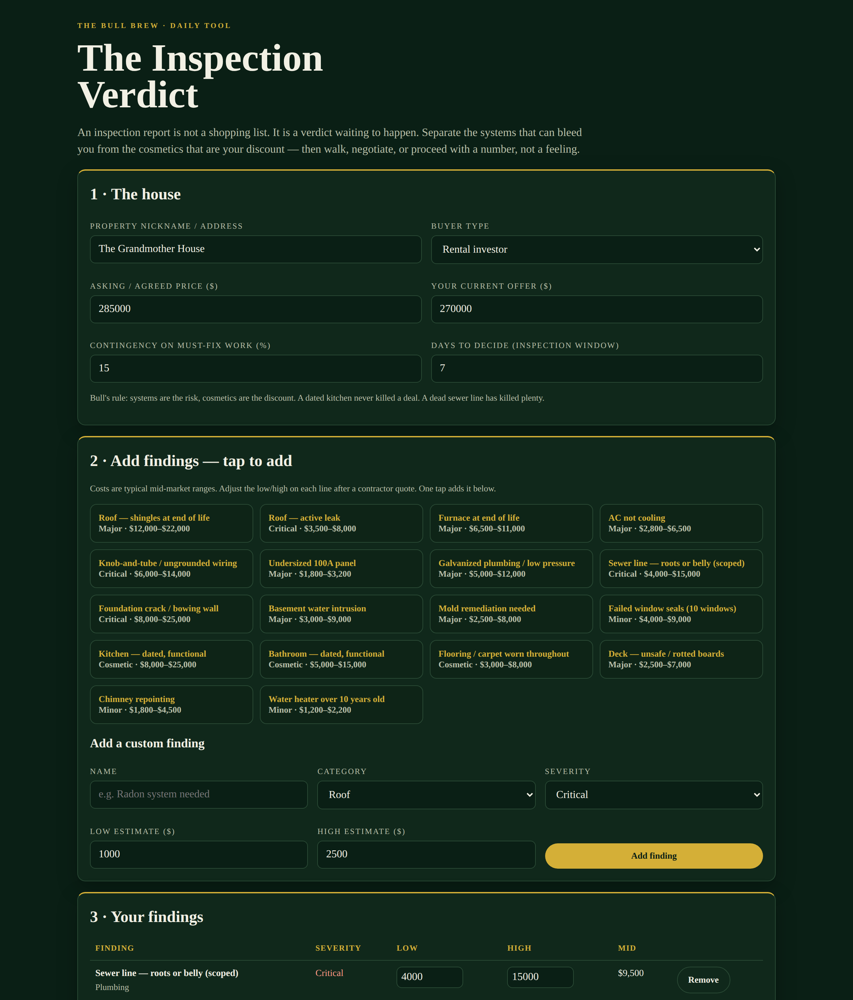
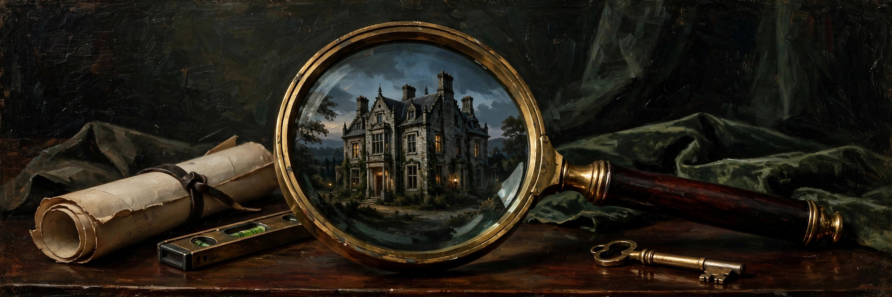

# The Inspection Verdict

**Live:** https://thebullbrew.github.io/inspection-verdict/
**Repo:** https://github.com/thebullbrew/inspection-verdict

## What it does

An inspection report is not a shopping list — it is a verdict waiting to happen. The Inspection Verdict sorts it honestly:

- **The honest split** — every finding priced low/high and sorted into Must-Fix (Critical + Major systems), Soon (Minor), and Cosmetic. A dated kitchen never killed a deal; a dead sewer line has killed plenty.
- **WALK / NEGOTIATE / PROCEED verdict** — rendered as a wax-seal badge, driven by must-fix cost as a share of price and the count of Critical findings, with different caution language for primary-home buyers vs rental investors.
- **Credit ask + revised max offer** — must-fix mid-estimates plus your contingency percentage becomes the credit to ask for (credit, not seller repairs) and the repriced offer to return at.
- **One-tap library** — 18 common findings (roof, sewer scope, knob-and-tube, foundation, mold, dated kitchen/bath, and more) with typical cost ranges, plus custom findings and editable quotes.
- **Optimism test** — sensitivity table at base, +25%, and +50% cost overruns, so you know if the deal survives honest contractor pricing.
- Saveable inspections (localStorage) and a copy-ready negotiation summary for your agent.

## The method

1. Sort before you sum — adding a cosmetic kitchen to a sewer emergency hides the emergency inside the wishlist.
2. Price the mid, pad the must-fix — contractors find friends behind walls; contingency is experience, not pessimism.
3. Ask for credit, not repairs — seller repairs are done cheap and fast; a credit lets your contractor do it right.
4. Reprice, don't panic — most bad inspections are price corrections, not walk-aways, for a calm buyer with quotes in hand.

## How to run

Open `docs/index.html` in any browser, or visit the live link above. Fully static, works offline as a PWA, no backend, no data leaves your device.

Design: dark old-money variation 4 — Emerald Vault.
